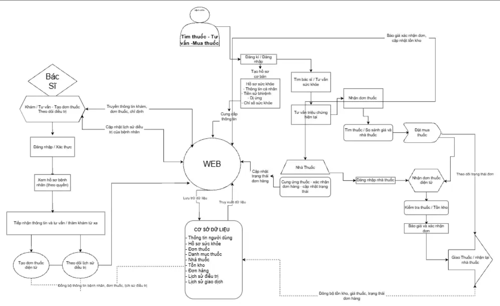

# BriMed (Since 2026) — Toa thuốc điện tử nhanh tại quầy

> **Tài khoản theo vai trò (không còn tài khoản demo):** admin 0900000001/admin123 · bác sĩ 0908888881 hoặc 0908888882 /123456 · nhà thuốc 0907777771–73 /123456 · bệnh nhân tự đăng ký.
>
> **Phiên bản: Giai đoạn 4 — Bản hoàn thiện, sẵn sàng thương mại hóa.** Đầy đủ phạm vi 4 giai đoạn: nền móng, khám–kê đơn từ xa, vận hành nhà thuốc & quản trị, cùng phần hoàn thiện nội dung/marketing và kiểm thử các tình huống đặc biệt.
> Branch này chứa phạm vi Giai đoạn 1: thiết kế mobile-first, dữ liệu mẫu Gò Vấp, tài khoản & phân quyền 4 vai trò, các trang thông tin công khai. Phân hệ khám–kê đơn từ xa, nhà thuốc và quản trị thuộc các giai đoạn tiếp theo.

**"Đơn thuốc an toàn cho bạn an tâm"** · *Không có đơn? Gặp bác sĩ ngay tại quầy — 10 phút tại quầy thay vì nửa ngày ở bệnh viện.*

Nền tảng web mobile-first kết nối **Bệnh nhân – Bác sĩ – Nhà thuốc**: khách quét mã QR tại quầy nhà thuốc đối tác (Gò Vấp, TP.HCM), điền form sàng lọc triệu chứng theo danh mục **TT 30/2023/TT-BYT**, bác sĩ từ xa gọi ngắn 1–2 phút và ký số đơn thuốc điện tử liên thông theo **TT 26/2025/TT-BYT**, nhà thuốc xuất bán ngay tại quầy (~6,5 phút).



## Kiến trúc

| Thành phần | Công nghệ | Cổng |
|---|---|---|
| `server/` — REST API thật | Node.js + Express + TypeScript (tsx) + better-sqlite3 | 4000 |
| `web/` — SPA mobile-first | React 18 + Vite + TypeScript + Tailwind CSS + React Router + Zustand | 5173 (dev, proxy `/api`) |
| CSDL | SQLite (file `server/data/brimed.db`) — 13 bảng: `users`, `health_profiles`, `consultations`, `prescriptions`, `medicines`, `pharmacies`, `inventory`, `orders`, `transactions` + `sessions`, `substitution_requests`, `reminders`, `partner_registrations` | — |

## Chạy dự án

```bash
# 1) Cài dependencies cả hai phần + nạp dữ liệu mẫu
npm run setup

# 2) Chạy dev (server :4000 + web :5173 đồng thời)
npm run dev

# Build production web (output: web/dist)
npm run build

# Chỉ nạp lại dữ liệu mẫu (reset về trạng thái ban đầu)
npm run seed
```

Mở **http://localhost:5173**. Trang quản trị cũng có nút **"Reset dữ liệu mẫu"**.

## Tài khoản demo (quick-login 1 chạm ở trang Đăng nhập hoặc nút 🔄 Chuyển vai trò ở góc phải)

| Vai trò | Tài khoản | Ghi chú |
|---|---|---|
| Bệnh nhân | Nguyễn Thị Lan · 0901234567 / 123456 | 20 token + 2 toa miễn phí đầu |
| Bác sĩ | BS. Nguyễn Văn Minh · 0908888881 / 123456 | Nội tổng quát, đang trực |
| Nhà thuốc | NT Minh Châu · 0907777771 / 123456 | 128 Nguyễn Oanh, P.17, Gò Vấp — gói 3 tháng |
| Quản trị viên | 0900000001 / admin123 | KPI vận hành toàn hệ thống |

## 21 trang (19 trang chính + 2 landing B2B chuẩn SEO)

**Công khai** `/` trang chủ (hero + quy trình 5 bước + 2 gói B2B + Form 2 đăng ký đối tác) · `/goi-1-thang-brimed-nha-thuoc` · `/goi-3-thang-brimed-nha-thuoc` (Title/H1/Meta đúng đặc tả SEO) · `/auth` (đăng nhập/đăng ký + quick-login 4 vai trò)

**Bệnh nhân** `/patient/dashboard` · `/patient/health-profile` (RBAC chia sẻ hồ sơ) · `/patient/consultation` (Form 1 + sàng lọc cờ đỏ) · `/patient/prescriptions` (mua tại quầy 3 token / mang đi 4 token) · `/patient/search` (so sánh giá & tồn kho) · `/patient/orders` (timeline 4 trạng thái) · `/patient/history-reminders` (nhắc Sáng/Trưa/Tối)

**Bác sĩ** `/doctor/dashboard` (hàng đợi + đồng hồ SLA <5 phút) · `/doctor/patient-record` (chỉ khi bệnh nhân đồng ý) · `/doctor/consultation/:id` (gọi ngắn mô phỏng + duyệt/từ chối) · `/doctor/prescriptions` (trình kê đơn TT 26/2025 + cảnh báo kháng sinh + duyệt đổi hoạt chất)

**Nhà thuốc** `/pharmacy/dashboard` (thống kê + QR standee + gói thuê bao) · `/pharmacy/inventory` (CRUD tồn kho) · `/pharmacy/receive-prescription` (quét mã + đối chiếu kho) · `/pharmacy/quote-confirm/:id` (báo giá + chốt) · `/pharmacy/orders` (4 trạng thái, hoàn tất tự trừ kho + ghi giao dịch)

**Quản trị viên** `/admin/dashboard` (KPI: toa/tháng, thời gian chờ TB ≤5 phút, tỷ lệ từ chối, **tỷ lệ toa có kháng sinh cảnh báo ngưỡng 30%**, tỷ lệ quay lại, doanh thu B2B/B2C + quản lý tài khoản, danh mục thuốc, danh mục bệnh TT 30/2023, đăng ký đối tác)

## Luồng demo end-to-end (dữ liệu lưu phía server — chuyển vai trò vẫn thấy)

1. **Bệnh nhân** gửi Form 1 (dùng ca cúm nhẹ; thử ca sốt >3 ngày/khó thở để xem **cảnh báo cờ đỏ khóa nút gửi**)
2. **Bác sĩ** thấy yêu cầu trong hàng đợi (SLA đếm ngược) → gọi ngắn → kê 2 thuốc → ký số → đơn `VN-Rx-2026-XXXXX` phát hành
3. **Bệnh nhân** vào Đơn thuốc → *Mua tại quầy (3 token)* → chọn NT Minh Châu (toà miễn phí đầu dùng tự động)
4. **Nhà thuốc** Tiếp nhận → nhập mã đơn → đối chiếu tồn kho → báo giá → chốt → chuyển 4 trạng thái → **Hoàn tất** (tự trừ kho + ghi giao dịch + thù lao bác sĩ 6.000đ/toa)
5. **Thiếu hàng?** Nhà thuốc bấm *Yêu cầu bác sĩ đổi hoạt chất tương đương* → **Bác sĩ** duyệt thuốc thay thế (cùng hoạt chất/nhóm còn hàng) → đơn được ký số cấp lại
6. **Quản trị viên** xem KPI; dữ liệu mẫu reset được bất cứ lúc nào

## Ghi chú

- Bảng màu đúng đặc tả: primary `#0d71e2`, pink `#e8408a`, sky `#a6d3fd`, pastel pink `#f980b5`, light blue `#B9D9FF`, light pink `#FFC2DD`, blue dark `#0756AF`, pink dark `#B92A69`, mint `#E6F4EA/#1E8E3E`, red flag `#FCE8E6/#D93025`. Font *Be Vietnam Pro*. Nút bấm ≥44px.
- Logo/banner thương hiệu: `web/public/assets/`.
- Mật khẩu hash SHA-256 + session token (demo); RBAC chặn truy cập chéo vai trò ở cả middleware API lẫn route guard frontend.
